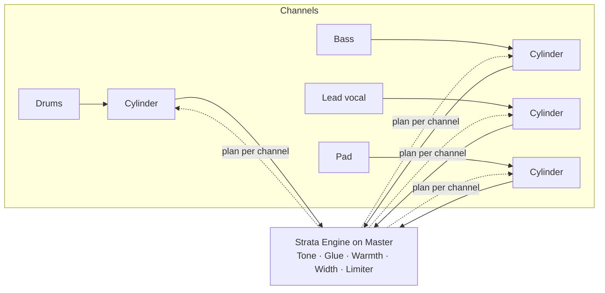

# Strata

A mastering plugin built like a stack of adjustment layers. Four layers you can reorder, each with
on/off and **opacity** (how much of the layer is blended over what is below it), and a true-peak
limiter that always sits last. Loudness meters (EBU R128 / ITU-R BS.1770-4) show input and output,
with a loudness target and a one-click "gain to target". Put a Strata Cylinder on every channel and
the Engine balances the whole mix for you (see [Engine + Cylinders](#engine--cylinders-auto-balance)).

Site: https://gtkottman.github.io/strata/

VST3 and CLAP, 64-bit Windows (built here by cross-compiling from Linux). Linux builds work too.

## Layers

| Layer | What it does | Controls |
|---|---|---|
| Tone | Mastering EQ; Presence and Air are matched to the analog curve up to Nyquist (no cramping) | Low cut, Low shelf 110 Hz, Body 400 Hz, Presence 3 kHz, Air shelf 10 kHz (±6 dB) |
| Glue | Stereo-linked bus compressor, 6 dB soft knee, high-passed detector so kick and bass don't drive it | Threshold, Ratio, Attack, Release, Makeup, Sidechain HPF (100 Hz; 20 = off) |
| Warmth | Soft tanh saturation, 4x oversampled (no aliasing), plus asymmetric grit on the bass band | Drive, Bass grit |
| Width | Mid/side width with bass to mono (off by default) | Width 0–200 %, Mono below, Linear phase |
| Limiter (out) | Lookahead true-peak limiter, 1.5 ms lookahead, program-dependent release, optional clipper before it | Input gain, Ceiling (dBTP), Release, Auto release, Clipper, Clip above ceiling |

Use Up/Down on a layer to move it. Opacity changes and on/off are ramped, so they never click.
Latency is reported to the host: 1.5 ms + 140 samples (lookahead plus the two 4x oversamplers),
plus 42.5 ms while Width's linear phase is on.

- **Auto release**: a lone peak recovers at about half the release time, sustained limiting at about
  three times it, so a dense loud passage doesn't pump.
- **Clipper**: a 4x oversampled soft clipper before the limiter. Peaks are clipped to "Clip above
  ceiling" dB over the ceiling and the limiter takes them the rest of the way. It is distortion: use
  it on dirty genres, leave it off where the kick and sub must stay clean.
- **Linear phase** (Width): bass to mono without shifting the side channel's phase.

## Engine + Cylinders (auto-balance)

Strata balances a whole mix for you, once per song, and then holds that balance still. It is not
free-running auto-gain: it **learns** the song in one pass, **plans** every channel's level from
what it heard, and then plays that plan back locked to the song position, the same way on every
playback and every render.

The DLL holds two plugins that find each other inside the host:

| Plugin | Where it goes | What it does |
|---|---|---|
| **Strata Cylinder** | First insert slot of **every** instrument's mixer track | Listens to its channel while learning (level, attacks, low/mid/high bands, stereo side, per beat), then becomes that channel's gain and width stage |
| **Strata** (the Engine) | The **Master** track | The mastering chain (layers + limiter + meters) and the brain: starts and stops learning, makes the plan, sends each Cylinder its part |



### The process, once per song

1. **Set up.** Route every instrument to its own mixer track and put a **Strata Cylinder** in slot 1
   of each. Name it and give it a role (below), or leave it on Auto and it guesses from what it
   hears. Put **Strata** on the Master and pick a **Genre** (or Neutral). Leave the channel faders at
   0 dB: Cylinders set the levels, and faders still apply after them.
2. **Learn.** In the Engine's BALANCE card press **Start learning**, then play or render the whole
   song from the start. Each Cylinder counts the beats it learned.
3. **Balance.** Press **Stop learning + Balance**. The Engine plans every channel and the Cylinders
   start following it at once. The card lists each channel's role, gain and width.
4. **Set the loudness.** Press **Reset meters**, play or render the whole song again, then
   **Apply to limiter input gain**. This brings the balanced mix to the loudness target (the
   genre's, or the Target slider in Neutral).
5. **Render** the final mix.

The plan is saved with the project, so reopening it plays the same balance. Learn again (steps 2-3)
only when the arrangement changes. After changing roles, trims or the genre, **Balance again**
re-plans from what was already learned without replaying the song.

### Roles

| Role | Use it for | How the plan treats it |
|---|---|---|
| Drums | Kits, loops, percussion | Fixed level, never boosted or ducked by moments |
| Bass | Bass, sub, 808 | Fixed level, mono |
| Lead | Lead vocal, solo instrument | Can be featured |
| Keys | Piano, guitars, any moving melodic line | Can be featured |
| Pad | Pads, drones, held chords | A bed: sits back while something moves |
| Texture | Noise, risers, rain, ambience | A bed, quietest by default |

### What the plan does

- **Static balance** (whole song): each channel's loudness while it plays is moved towards the
  genre's level for its role. Neutral: drums 0, bass -2, lead -1, keys -5, pad -9, texture -15 dB
  relative to the mix. At most +-9 dB.
- **Moments** (per beat, Lead and Keys only): one part moving alone, a solo or near-solo, comes up
  +3 dB; two moving +1.5 dB each; three moving, the busiest +1 dB; four or more, the busiest +1 dB and
  the other movers -1.5 dB. Pads, drones and textures sit back 1.5 dB while something moves; a lone
  held melodic part with nothing moving is the feature (+1.5 dB). Smoothed over 3 beats, read a
  quarter beat ahead so a boost arrives with the note, at most +-6 dB.
- **Width** (whole song): each channel gets the genre's width for its role (bass mono, pads wide),
  capped so an already-wide channel never ends with its side louder than 2.2 dB under its middle.
  A mono channel can't be widened, and the report says so.

### Steering it

- Engine: **Static balance**, **Moments** and **Width plan** sliders scale each part of the plan
  (0-100 %); the **BALANCE** toggle switches the whole plan off.
- Cylinder: **Trim** (-24 to +12 dB) sits on top of the plan, for example about -6 dB on a vocal that
  sits too far forward. **Follow Engine** off takes one channel out of the plan.
- After a trim, Reset meters, play or render, and Apply again so the loudness still hits target.

### The report

Every balance writes `Documents\Strata\report.json`: each channel's role (and whether it was
guessed), loudness, static offset, width and per-bar gain curve, plus the list of moments (bars,
who is featured, who sits back). It is there so a person, or Claude, can check the balance from
numbers.

## Meters

Output: integrated, short-term and momentary loudness, true-peak max, correlation, Glue and limiter
gain reduction, and the largest limiter reduction of the pass (a warning shows past 6 dB: get the
loudness from Glue instead). **Compare 1:1** plays the input at the output's loudness, so switching
it on and off judges the processing and not the level; the meters keep measuring the processed output. Input: integrated, short-term, true-peak max. Play the whole song, read the
integrated loudness, then **Apply to limiter input gain** to reach the target. Reset meters before
each full pass.

## Install (Windows)

Download `Strata-windows.zip` from the latest release and unzip it.

- VST3: copy the `Strata.vst3` folder to `C:\Program Files\Common Files\VST3\`
- CLAP: copy `Strata.clap` to `C:\Program Files\Common Files\CLAP\`

In FL Studio: Options > Manage plugins > Find more plugins (or Start scan), then add **Strata** to the
Master mixer track.

## Build

```sh
cargo test --lib                # DSP tests: EBU 3341 loudness, true peak, limiter ceiling, bypass
./build-windows.sh              # needs: rustup target add x86_64-pc-windows-msvc; cargo install cargo-xwin
cargo run --release --bin strata-render -- in.wav out.wav [limiter-gain-dB] [ceiling-dBTP]
```

`strata-render` runs the default chain offline and prints loudness before and after.

## License

GPL-3.0-or-later (VST3 support comes through nih-plug's GPLv3 VST3 bindings).
